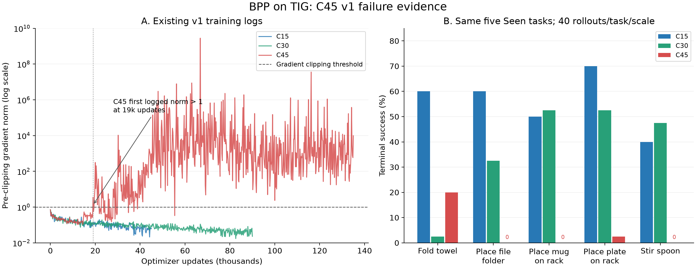
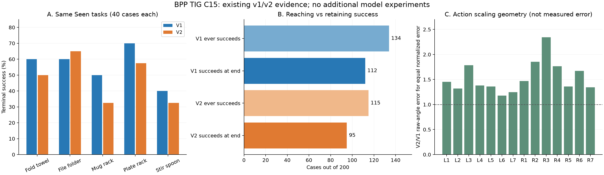

# 历史测评与修正记录

This is the single historical record for the earlier BPP/TIG run. Current methods and final measurements are in the English/Chinese README. Historical scores, diagnosis, comparisons and reproduction notes are consolidated here; raw result data and source snapshots retain their original identities.

本文集中记录原 `v1` 测评、已确认的工程问题、旧 C45 异常、C15 前后差异、历史提示诊断和复现来源。当前方案与正式主结果见 [中文说明](README_CN.md) / [English README](README.md)。历史分数仅用于追溯，不与当前配方逐格选优拼表。

这次文档整理不增加训练、推理、仿真、回放、消融或测试，也不更改任何已有 checkpoint 或测评分数。CSV、JSON、源码快照中的原始实验标识保留；原始逐例证据留存本地，公开包仅提供摘要。

## 1. 历史配方与测量范围

历史训练使用 `legacy_quantile`：动作目标按训练池 q01/q99 归一化但不裁剪，DDIM 推理沿用 `clip_sample=True`、range1。本地 TIG 训练未持续更新 EMA，也未加入源方法的独立 epsilon 输入扰动。外部 BPP-LIBERO checkpoint 的 HF `model` 键原本包含源 EMA 权重；“本地未更新 EMA”不等于“外部初始化未加载 EMA”。

历史记录完成七个训练阶段、十个唯一评测组、2,000 条正式 rollout，包含 checkpoint 哈希、500 控制步和 worker 正常退出核验。每个单元格为五任务×L0–L3×十个 seed，共200回合。三行 Scratch 引用同一个目标任务模型和同一组200回合，不是三次独立重复。Scratch 仍使用共同外部 BPP-LIBERO 初始化，只跳过 TIG Ck 预训练。

以下主指标是末态成功率；Once 表示500步内任意时刻成功过。连续奖励代理 `SubSR_released_code_proxy = mean(last_normalized_reward)` 不能当作论文按阈值统计的子任务成功率。

### 历史末态成功率 SR（%）

| 档位 | Seen | Zero-shot | Scratch（共享） | P+FT |
|---|---:|---:|---:|---:|
| C15 | 56.0 | 1.0 | 2.0 | 40.0 |
| C30 | 37.5 | 1.0 | 2.0 | 50.5 |
| C45 | 4.5 | 5.0 | 2.0 | 6.0 |

### 历史曾经成功率 Once（%）

| 档位 | Seen | Zero-shot | Scratch（共享） | P+FT |
|---|---:|---:|---:|---:|
| C15 | 67.0 | 2.0 | 2.0 | 44.5 |
| C30 | 49.5 | 1.0 | 2.0 | 52.0 |
| C45 | 7.5 | 5.5 | 2.0 | 6.0 |

### 历史连续奖励代理

| 档位 | Seen | Zero-shot | Scratch（共享） | P+FT |
|---|---:|---:|---:|---:|
| C15 | 0.8502 | 0.1344 | 0.1951 | 0.6058 |
| C30 | 0.7452 | 0.1636 | 0.1951 | 0.7104 |
| C45 | 0.3586 | 0.2708 | 0.1951 | 0.2751 |

历史末态三档算术均值为 Seen32.67%、Zero-shot2.33%、Scratch2%、P+FT32.17%。均值不增加独立样本。

历史明细：[分组表](metrics/v1_clip1/groups.csv)、[分等级表](metrics/v1_clip1/per_level.csv)、[逐任务等级表](metrics/v1_clip1/per_task_level.csv)、[训练表](metrics/v1_clip1/training.csv)、[已核验原始审查](metrics/v1_clip1/review.json)。

## 2. 已确认的工程问题及修正边界

分位数归一化允许训练目标越过±1，但 DDIM 的最终归一化输出被限制在±1，因而不能表示输出框之外的原始关节目标。这是训练/采样支持范围不一致；物理控制器的 clip_count 为0不能排除它。DDIM 的限幅发生于推理 `step`，训练使用 `add_noise`，因此限幅操作本身不能直接产生反向传播中的梯度爆炸。

当前主配方改用训练池14个关节的完整 min/max、原生夹爪 identity，补回源独立输入扰动0.1与训练 EMA；查询状态仍用训练池分位数，DDIM仍为clip1。旧权重不会因为换一份统计量而成为当前训练结果。三项修改同时发生，没有分项对照；不能由最终成绩确定旧异常的触发器或各项贡献。EMA在优化器更新之后平均参数，不参与raw模型反向传播，不能解释成“EMA平滑了裁剪前梯度”。

## 3. C45 低分与优化异常

历史 C45 的低分伴随持续、明显的训练优化异常。现有证据优先支持“异常预训练模型被目标微调继承”的解释；触发模块、样本或数值机制尚未定位，不能据此推断原始 BPP 会随任务数增加而退化。

| 历史阶段 | 记录数 | 裁剪前梯度中位数 | 最大值 | 范数>1 | 末20%日志loss中位数 |
|---|---:|---:|---:|---:|---:|
| C15 | 226 | 0.113 | 0.708 | 0 | 0.002155 |
| C30 | 451 | 0.082 | 0.712 | 0 | 0.001622 |
| C45 | 676 | 302.97 | 2.7995×10⁹ | 548 | 0.021098 |

C45首次记录到范数>1在19,000更新，20,000更新已有>100，66,800更新达到最大值，结束时仍为9,771；末20%的136个记录全部>1。p90约33,706。日志为step1及每200更新的rank0裁剪前值，548/676不是全部135,000更新的异常比例。训练器能拒绝NaN/Inf，但极大的有限梯度仍可能通过；完成预算和正常退出不能替代训练健康判断。

三档目标微调使用相同目标数据、CLS、目标统计和3,000更新预算。历史C15/C30/C45的P+FT为40/50.5/6%，末20%loss中位数为0.003534/0.002382/0.018674。C45微调step1范数5,210,653，step200仍为83,901；末段loss约为C30微调7.8倍。预训练末段loss约为C30的13倍，但预训练任务混合不同，不能当作同一验证集精度比较。

Seen三档评测使用相同任务、等级和reset seeds。每任务40回合的历史成功数为：

| 任务 | C15 | C30 | C45 |
|---|---:|---:|---:|
| FoldTowel | 24 | 1 | 8 |
| PlaceFileFolder | 24 | 13 | 0 |
| PlaceMugRack | 20 | 21 | 0 |
| PlacePlateRack | 28 | 21 | 1 |
| StirSpoon | 16 | 19 | 0 |

FoldTowel并非单调下降，Zero-shot也由1/1/5%变化，不能说所有能力同时消失。MugRack专家关节目标在三档输出框均100%覆盖，成功却20/40→21/40→0/40；“专家目标超出输出框”不足以完整解释该任务下降。专家覆盖也不保证在线纠偏动作均可达。

既有只读排查覆盖C45全部9,000条机器人轨迹、3,039,478数值帧，未发现非有限标签、非法夹爪、明显列序/单位或绝对/增量混用。状态归一化未出现C45特有数量级放大，最大绝对值约2.69；共享任务数值样本、role/repo/episode索引、manifest和源文件哈希对应。未重新计算全部RGB/CLS特征。checkpoint优化器计数、scheduler与四个normalizer buffer匹配，135,000更新确实完成。三档名义锚点暴露次数约2.79/2.71/2.84，不能只凭任务增多断言旧任务样本饥饿。每档63个小参数张量静态检查未发现非有限或数量级异常；没有全面检查大卷积、FiLM、激活、Jacobian或优化器动量。

原日志没有每步任务身份、每层梯度与实际参数更新范数。任务混合干扰、数值敏感性及源训练配方差异仍属候选机制。源BPP与TIG DP都可使用BF16，不能把BF16本身当作已发现的配置错误。梯度裁剪系数作用于AdamW之前，不等于参数更新按相同比例缩小，更不能据此断言参数被冻结。

历史分析曾将源优化器参数分组、betas(.95,.999)、总步数5% warmup与clip0.3列为异常复发时的候选处理；当时TIG适配实际使用betas(.9,.999)、Ck100步warmup与clip1。这些差异本身不是已定位的bug，候选方案没有在本轮单独执行或验证；没有以临时只调C45的方式拼接当前结果。

当前C45的676个记录最大范数0.714677、没有记录>1，末10点中位数0.031474；Seen66%、P+FT56%、Zero-shot4%。这说明当前联合配方在这次运行中没有复现旧记录的优化病态，不能确定单项修正效果。健康门槛和准入规则见 [TRAINING_HEALTH.md](TRAINING_HEALTH.md)。



## 4. C15 前后结果对比

| C15口径 | 历史末态成功 | 当前末态成功 |
|---|---:|---:|
| Seen | 112/200，56% | 95/200，47.5% |
| Zero-shot | 2/200，1% | 6/200，3% |
| Scratch | 4/200，2% | 10/200，5% |
| P+FT | 80/200，40% | 75/200，37.5% |

同case有43例成功变失败、26例失败变成功，净少17。两轮200个task_id+seed、示范视频及帧索引、等级、环境源码、控制模式、500步、42次策略查询和分片映射对应，worker均正常退出；未找到新增评测循环错误。`run_episode`、`joint_actions`、`NativeBPPModel.predict_action`的静态语法树一致。各case分别重置Python/NumPy/Torch/CUDA RNG；未保存原始噪声，不能证明逐bit一致。

数据manifest、冻结CLS、外部初始化、双臂新层init、state统计、globalbatch64、45k更新和优化器超参数一致，单双臂映射不是前后新增变量。两轮各226条梯度日志均未超过1，不能套用旧C45病态解释下降。

| C15任务，各40回合 | 历史末态成功 | 当前末态成功 | 差值 |
|---|---:|---:|---:|
| FoldTowel | 24 | 20 | -4 |
| PlaceFileFolder | 24 | 26 | +2 |
| PlaceMugRack | 20 | 13 | -7 |
| PlacePlateRack | 28 | 23 | -5 |
| StirSpoon | 16 | 13 | -3 |

分等级成功数差值L0/L1/L2/L3为-12/-7/-3/+5。Once成功134→115，Once后未保持到终态22→20，达到成功后的终态保持率约83.58%→82.61%；总体少成功主要来自更少case达到成功。PlateRack例外：Once仍33/40，末态28→23，保持问题加重。

动作坐标、输入扰动与raw→EMA评测同时变化。14关节min/max跨度相对q01/q99为1.177–2.345倍，中位1.419倍；同一归一化误差换回角度会乘以相应尺度，但未实测误差因此增加。右臂第3关节中心98%区间由归一化宽2缩到约0.853。实际action_scale/offset已核对生效，state buffer不变；夹爪坐标原本为identity。

独立噪声方案由epsilon加噪改为epsilon+0.1*z加噪、仍回归epsilon。理想独立高斯条件方差0.01/1.01约0.0099，且动作坐标改变，不能以训练loss约0.002→0.011直接判定优化变差。额外随机抽样也改变优化噪声序列。EMA433个唯一参数的名称、shape、step、别名处理、冻结视觉参数与normalizer核对通过；45k更新decay约0.999800，局部平滑尺度约5001更新。实现正确不保证SR提高；没有raw/EMA额外评测，无法分离贡献。

C15 Seen当前8例、120/100000控制步触发物理限幅，均为左臂J7；历史计数为0。训练min值-2.9037576rad略低于URDF下限-2.8973rad，相差约0.0064576rad/0.37°。43个丢失成功中3例涉及限幅，另外5个限幅case有1例仍成功；MugRack唯一限幅case前后均失败。它不足以完整解释下降，计数也不记录实际越界幅度，不能把0.37°当作每次实测误差。

当前全部结果统一采用同一配方。C15 P+FT40%→37.5%、C30 P+FT50.5%→46%的回落同样保留，未逐格选优。没有追加消融来决定旧异常触发器或分项贡献。



## 5. 历史能力审查与统计边界

当时C15/C30能力审查覆盖1,400个唯一正式case。P+FT相对共享Scratch的配对赢/输为77/1、97/0，五个目标任务净贡献均为正；该配对分析未扩展到旧C45。十个固定Seen状态的首次动作对提示替换敏感，但不能证明未见人类泛化、完整时序模仿，或分别定位人类域适配和双臂接口的代价。当前正式测评没有新增prompt消融，历史诊断不能当作当前模型的实验。

各方法对齐的是任务拆分、人类视频提示/机器人动作监督、L0–L3、500步和原任务成功谓词。初始化、视频编码、prompt抽样、动作表示、query-window与episode单位、batch和更新暴露有差异。相同更新数不等于样本、epoch或FLOPs相同，不构成论文数值的严格复现或算力匹配排名。

每条谱系只有一个训练seed、五个固定任务簇，等级/示范/重置case相关，Scratch共享；不把2000回合当作2000次独立训练重复。源审查未发现列出的左右臂顺序/单位/绝对增量混用，不代表适配已被证明无损。

## 6. 历史提示诊断协议

以下保留原固定队列协议。它属于历史模型的辅助诊断，不计入四口径正式SR，不用于选checkpoint，也不授权新增实验。

`diagnose_bpp_imitator.py` is separate from all four formal evaluation regimes.
It accepts only a completed, explicitly non-pilot, human-prompt C15 45000-update
checkpoint. Its weights and training settings are never selected by this diagnostic.

The predeclared cohort is the five official Seen tasks at L0, reset seeds 100000
and 100001. Each scene runs twice: its correct human RGB clip, and the same episode
index from the next task in the official Seen task order (cyclic permutation).
Both conditions use the same reset/per-episode RNG seed, 500 controls, execution
horizon 12, native qpos18/RGB observations, physical action16, and rt-fast renderer.
The twenty cases and permutation are written to `diagnostic_plan.json`.

From the TIG repository root, after sourcing project storage.env:

```bash
CHECKPOINT="$BPP_ROOT/results/training/c15_human_cls_ddp8/final.pt"
OUTPUT="$BPP_ROOT/results/diagnostics/c15_paired_prompt"
CUDA_VISIBLE_DEVICES=0 "$BPP_RUNTIME_PYTHON" -m examples.baselines.bpp.diagnose_bpp_imitator \
  --checkpoint "$CHECKPOINT" --output-dir "$OUTPUT" --num-shards 16 --shard-index 0
```

Run shard indexes 0–15, using two workers per GPU over eight GPUs. All workers
share the same output directory. Sharding is stable across worker counts.
Each public CLI launches a supervised worker, owns its assigned cases until native
process exit, and records the actual return code. A completed rollout from a worker
that exits abnormally is invalidated. Verified cases can be reused; unverified cases
and their videos/first-query files are archived before retrying. Case locks prevent
concurrent workers from claiming the same rollout. Immutable manifests reject mixed
weights or source configurations. A locked aggregate prevents stale partial snapshots
from overwriting a complete aggregate.

After every worker exits, rebuild and validate the whole cohort:

```bash
CUDA_VISIBLE_DEVICES='' "$BPP_RUNTIME_PYTHON" -m examples.baselines.bpp.diagnose_bpp_imitator \
  --checkpoint "$CHECKPOINT" --output-dir "$OUTPUT" --collect-only
```

`--plan-only` declares the cohort without opening the checkpoint or using a GPU.
Do not invoke the private worker flag directly.

Each case retains metrics, rollout.mp4, and first_query.npz. The latter contains the
first current RGB/qpos and raw/normalized predicted action chunk, with separate
current-observation and Torch RNG hashes. No extra model forward is introduced.
Paired action differences are reported only when both hashes match exactly.
The summary always has `diagnostic_only: true` and `formal_success_rate: null`.
All twenty rollouts must finish with verified exit 0 before condition-level
**diagnostic** rates are populated. Numerical action sensitivity is auxiliary.

A prompt-dependent output does not prove complete imitation or intent understanding.
A mismatched task may be incompatible with the scene. This test also cannot separate
human-domain adaptation from the difficulty of bimanual control. The fixed cohort and
checkpoint prevent this diagnostic from becoming a held-out model-selection loop.

## 7. 历史源码与记录复核

原始训练/评测产物保存在 `$BPP_ROOT/results/pipeline/bpp_human`，初始C15权重在 `$BPP_ROOT/results/training/c15_human_cls_ddp8`。原冻结源码为 `$BPP_ROOT/results/review/source_snapshots/bpp_primary_clip1_v1_20261116T023106Z/bpp`，同级manifest保留源码哈希。公开包的 `legacy/v1_clip1/bpp` 是对应历史Python源码，`legacy/v1_clip1/provenance.json` 保存来源；数据、权重、视频和原始case不随代码发布。

归档源码需置于匹配的TIG目录 `<TIG_ROOT>/examples/baselines/bpp`，在独立checkout复现。仅从嵌套归档路径运行入口不会自动切换canonical模块。既有记录可用当前report显式指定归档源码和原归一化模式复核，输出另存：

```bash
source "$BPP_ROOT/storage.env"
BPP_ARCHIVE_SOURCE="$BPP_ROOT/results/review/source_snapshots/bpp_primary_clip1_v1_20261116T023106Z/bpp"
"$BPP_RUNTIME_PYTHON" "$BPP_BASELINE_DIR/report_bpp_imitator.py" \
  --run-root "$BPP_ROOT/results/pipeline/bpp_human" \
  --c15-output "$BPP_ROOT/results/training/c15_human_cls_ddp8" \
  --source-root "$BPP_ARCHIVE_SOURCE" \
  --action-normalization legacy_quantile \
  --output-dir "$BPP_ROOT/results/review/recheck_historical_clip1" --verify-checkpoints
```

这里是既有artifact复核，不是新策略测评。只从已核验记录生成图可使用：

```bash
CUDA_VISIBLE_DEVICES='' "$BPP_RUNTIME_PYTHON" "$BPP_BASELINE_DIR/plot_bpp_imitator.py" \
  --review "$BPP_ROOT/results/review/all_scales_v1_clip1/review.json" \
  --output-dir "$BPP_ROOT/results/review/figures/historical_clip1" --with-levels
```

绘图导出300dpiPNG、SVG/PDF、源CSV与来源哈希；默认要求三档完整。历史正式资源核算为75.59224648899502 assigned GPU·小时，首尾正式进程窗口约10.398825小时；连续8卡预留假设为83.19059706423018 GPU·小时，口径不等于实测利用率/账单，也不包含下载预处理或所有历史失败开销。早期CPU preflight仅证明当时源码的检查结果，不能覆盖后来健康门槛、恢复观察器或资源选择器变更。

## 8. 证据与归并来源

公开历史数据文件职责如下：分组/等级/任务表记录SR、Once、奖励代理；training表记录训练预算及初始化/checkpoint哈希；review记录归档核验结论；provenance记录源归档校验；audit_summary JSON记录精简审查和原始审查哈希。完整原始审查及机器运行记录留在本地。

本文件整合了原主README中的旧结果、旧复现与C45分析，以及原 `PROMPT_DIAGNOSTIC.md`、归档结果README、归档源码README、旧audit_summary说明、C45低分分析、C15前后对比分析。分散的历史Markdown已从活动文档和公开仓库移除；原文在文档整理前快照中留存。

证据入口：[历史协议/适配/能力审查](metrics/v1_clip1/audit_summary.json)、[C45异常取证](metrics/v1_clip1/audit_summary.json)、[C15前后分析来源](metrics/v2_c15/audit_summary.json)。各历史审查的时间点不同；其中“等待C30/C45完成”“尚无健康门槛”等状态均为当时记录，不表示当前运行仍未完成。
