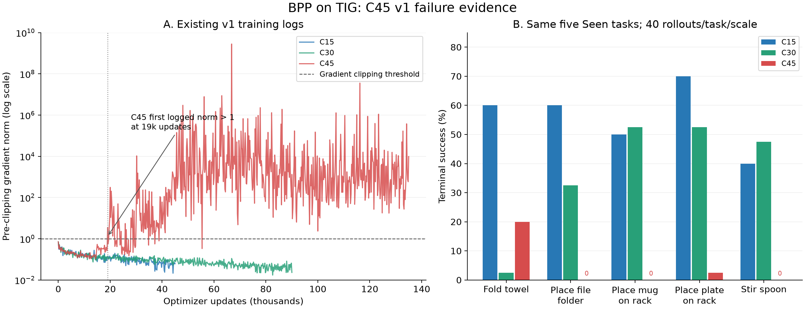

# C45 v1 低分分析

C45 的低分伴随明确、持续的训练优化异常。现有证据优先指向 C45 训练后模型质量下降，微调又继承了该模型；触发异常的具体模块、样本或数值机制尚未定位。现阶段不能把它直接作为“BPP 增加任务后能力下降”的结论，也不能声称归一化修正已经解决。

本报告只分析已经完成的 **v1：quantile action + DDIM clip1、无本地 EMA/输入扰动**。v2 为独立重训版本，不能沿用这些分数。没有新增 GPU 实验、推理、仿真或消融。

## 1. 异常已经出现在训练过程中

| 旧版模型 | 已记录梯度范数中位数 | 已记录最大值 | 已记录范数 > 1 | 预训练末20%日志 loss 中位数 |
|---|---:|---:|---:|---:|
| C15 | 0.113 | 0.708 | 0 / 226 | 0.002155 |
| C30 | 0.082 | 0.712 | 0 / 451 | 0.001622 |
| C45 | 302.97 | 2.7995×10⁹ | 548 / 676 | 0.021098 |

C45 第19,000步首次记录到范数 > 1，第20,000步已有 > 100，第66,800步达到2.7995×10⁹，训练结束时仍为9,771。末20%的136条日志全部 > 1。这与 C15、C30 的轨迹有明显区别。

这里的范数由 `clip_grad_norm_` 返回，表示 **裁剪前** 范数。日志仅包含第1步及每200步等记录，548/676不是135,000步中发生异常的精确比例。训练损失是8卡聚合的有效动作加权 epsilon 训练损失，预训练任务混合不同，不能当作同一验证集精度比较。

训练检查会拒绝非有限 loss/gradient，但极大的有限梯度仍可通过。因此，进程退出正常、预算完整，不意味着训练健康。AdamW 会归一化动量，梯度裁剪系数也不等于参数更新按相同比例缩小，不能说参数因此被冻结。

## 2. 微调对照更能说明问题来自起点模型

三个 P+FT 使用相同目标数据 manifest、CLS manifest、归一化统计和3,000步预算；主要区别是预训练起点。

| 旧版起点 | Seen 末帧成功率 | P+FT 末帧成功率 | 微调末20%日志 loss 中位数 |
|---|---:|---:|---:|
| C15 | 56.0%（112/200） | 40.0%（80/200） | 0.003534 |
| C30 | 37.5%（75/200） | 50.5%（101/200） | 0.002382 |
| C45 | 4.5%（9/200） | 6.0%（12/200） | 0.018674 |

C45 微调第1步的裁剪前梯度为5,210,653，第200步仍为83,901；后期虽有所恢复，同一目标流程下末段 loss 仍约为 C30 微调的7.8倍。它支持“异常预训练模型被微调继承”的解释，但没有定位到具体损坏参数。

## 3. 不能用换了更难的 Seen 测试任务解释

Seen 在三档使用相同五个基础任务及 L0–L3、相同重置种子。以下每格均为40回合中的成功数：

| 任务 | C15 | C30 | C45 |
|---|---:|---:|---:|
| FoldTowel | 24 | 1 | 8 |
| PlaceFileFolder | 24 | 13 | 0 |
| PlaceMugRack | 20 | 21 | 0 |
| PlacePlateRack | 28 | 21 | 1 |
| StirSpoon | 16 | 19 | 0 |

退化广泛但不一致：C45 的 FoldTowel 好于 C30，其余多项明显下降。C45 Zero-shot 为5%，高于 C15/C30 的1%，也说明不能说所有能力都同时消失。Scratch 的2%是三档共享的同一组目标训练/评测，不能当作三次独立结果。

## 4. 归一化与 DDIM 限幅确实有问题，但不足以单独解释 C45

v1 的分位数归一化训练目标可以越过 ±1，而 DDIM 采样限制输出在该范围内，这是已确认的训练/推理支持范围不一致。但 DDIM 的 `step` 限幅发生在推理，训练路径使用 `add_noise`，因此它本身不能直接执行出训练中的梯度爆炸。

MugRack 的已审查专家训练关节目标在 C15/C30/C45 输出框中均100%覆盖，成功数仍从20/40、21/40降到0/40。这排除了“该任务专家目标超出输出框”作为完整解释。专家覆盖是训练标签统计，不保证所有在线纠偏动作可达。

## 5. 已排查的具体工程原因

- 数值数据：只读核对 C45 全9,000条训练轨迹、3,039,478帧，未发现 NaN/Inf、非法夹爪、明显左右臂列序/单位/增量与绝对目标混用。
- 输入尺度：未发现 C45 状态分位数退化为近零区间；归一化状态最大绝对值约2.69，未出现 C45 独有数量级放大。
- 数据对应：共享旧任务的数值样本一致；CLS 通过 role/repo/episode 键索引，源文件哈希与 manifest 对应检查通过。未重新计算全部 RGB/CLS 特征。
- 训练预算：实际 checkpoint 的优化器计数、scheduler、四个归一化 buffer 与各自 manifest 一致；C45 确实进行了135,000步，并非少训练或读错 final。
- 数据暴露：三档名义每个锚点采样次数为2.79、2.71、2.84。原 Seen 任务绝对采样量大致相当，不能仅凭任务变多推断旧任务饿死。
- 小参数静态检查：每档63个小张量未发现非有限或数量级异常；没有检查全部大卷积/FiLM 权重、激活、Jacobian 或优化器动量。

这些检查只排除了列出的具体故障；不能据此证明单双臂和 RGB-only 改造无性能代价。相同接口在 C15/C30 上能成功，也不能排除它与45任务混合存在交互。

## 6. 尚未解决的因果问题与下一步

旧版没有保存每层梯度、每步批次任务身份和实际参数更新范数，不能从总范数逆推出触发模块。45任务混合造成的优化干扰、BF16 数值敏感性，以及与原 BPP 配方的差异，仍是候选因素。

既定 v2 主流程已经调整动作 min/max，并补回源输入扰动0.1与 EMA；保持独立输出、原任务划分和既定训练预算。分模块裁剪前梯度及裁剪系数随主训练记录，没有追加消融。应先看 v2 C45 的训练健康度，再判断最终成功率；v2 多项修正同时进行，成功率改善也不能分别归功于其中一项。输入扰动及动作坐标已改变，v1/v2 原始训练 loss 不可直接比较。

## 原始证据

- [公开审查摘要 JSON（完整原始审查留存本地）](../audit_summary.json)
- [数值与语义审查公开摘要](../audit_summary.json)
- [旧版全部分组结果](../groups.csv)
- [旧版逐任务级别结果](../per_task_level.csv)
- [本文训练统计 CSV](training_summary.csv)
