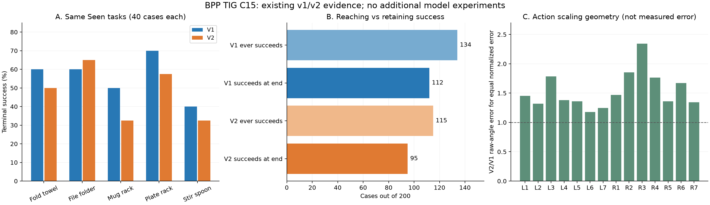

# C15 v2 Seen 下降与 C45 优化异常：只读分析

截至北京时间2026-11-16 14:47，既定 v2 C15 四口径已全部完成并通过现有 case/manifest/正常退出核验，各200回合。流水线已继续 C30。本次分析只读取已存在的源码、日志、checkpoint 元数据、小 buffer、案例记录及训练统计，未增加训练、推理、仿真、回放或测试。

结论：C15 的下降是组合训练配方与评测权重改变后观察到的真实结果；没有找到新增评测循环错误或 C45 式训练发散。动作尺度、输入扰动、EMA 同时变化，无法从这些结果分别确定各项因果贡献。C45 旧版则有持续极端梯度异常，应按优化失败处理，不能仅靠补回 EMA 宣称已解决。

## 1. 当前四口径

| C15 | v1 终态成功 | v2 终态成功 |
|---|---:|---:|
| Seen | 112/200，56.0% | 95/200，47.5% |
| Zero-shot | 2/200，1.0% | 6/200，3.0% |
| Scratch | 4/200，2.0% | 10/200，5.0% |
| P+FT | 80/200，40.0% | 75/200，37.5% |

P+FT 相对本版本 Scratch 的收益由38个百分点变为32.5个百分点，仍有明显预训练收益。以上只有单训练 seed、一次固定200-case评测；不据此估计训练重复之间的方差，也不把低基数 Zero-shot 的变化泛化为可靠能力提升。

## 2. 先排除计分或换协议的解释

两版 Seen 的200个 task_id+seed 一一对应；人类 prompt reference（含视频hash/帧索引）、等级flag、环境源码hash、控制模式、500控制步、42次策略查询和16个分片的case/device映射一致。均为200/200完成、0错误、正常worker退出。summary逐条对应metrics。

归档源码hash与各自manifest匹配。`run_episode`、`joint_actions`、`NativeBPPModel.predict_action` 三个函数静态语法树一致。每个分片进程自行持有模型，逐case重设Python/NumPy/Torch/CUDA RNG，不存在本次发现的中央actor跨case随机流交错问题；原始噪声和RNG状态没有保存，不能证明逐bit一致。

数据manifest、冻结CLS缓存、外部初始化权重、双臂新层init hash、state归一化、global batch64、45k更新、优化器超参数与模型结构保持一致。单双臂映射不是本次v1→v2的新增变量。

## 3. 实际少成功在哪里

| 同一任务，各40回合 | v1终态 | v2终态 | 差值 |
|---|---:|---:|---:|
| FoldTowel | 24 | 20 | -4 |
| PlaceFileFolder | 24 | 26 | +2 |
| PlaceMugRack | 20 | 13 | -7 |
| PlacePlateRack | 28 | 23 | -5 |
| StirSpoon | 16 | 13 | -3 |

同case有43个成功→失败、26个失败→成功，净少17。按等级成功数变化为 L0 -12、L1 -7、L2 -3、L3 +5。结果不是所有任务、所有等级同时崩溃。

全体once成功134→115；once后未保持到终态22→20；达到成功后的终态保持率83.58%→82.61%。总体下降主要来自更少case达到成功。PlateRack是具体例外：once仍为33/40，终态28→23，说明其保持问题加重，不能把总体解释直接套给每项任务。

## 4. 三项改动怎样影响结果

### 动作 min/max 扩大了范围，也改变精度和扩散信噪比

v1 q01/q99框对大部分Seen动作形成较窄的隐含约束。v2使用训练min/max，使训练动作可被clip1采样器表示，纠正了支持范围不一致；同时改变了动作坐标与扩散建模难度。

对14关节，min/max跨度相对q01/q99跨度为1.177–2.345倍，中位1.419倍。相同归一化预测误差映回原始关节角时，角度误差会按该比例变化；右臂第3关节的中心98%动作区间在归一化空间由宽2缩到约0.853。这给精细操作下降提供了可能机制，不能据此声称实测误差已经增大相同比例。

源统计JSON对象相同并非归一化没有生效：它同时包含min/max和分位数；checkpoint的实际action_scale/offset已逐值核验为新版公式，state buffer保持不变。C15夹爪v1本来就是identity，本次没有改变夹爪坐标。

### 输入扰动改变了训练目标的可比基线

v1用epsilon加噪并回归epsilon；v2用epsilon+0.1*z加噪，仍回归epsilon，符合源BPP。理想独立高斯条件方差为0.01/1.01≈0.0099，因此v2 loss约0.011与v1约0.002不能直接作好坏比较。加上动作坐标也变了，不能以loss变高作为失败原因。相同训练seed也不等于同一优化噪声序列，因为新版增加了随机数抽样。

两版各226条已保存梯度记录均未超过1，最大值分别0.7083/0.7074，最终范数0.0616/0.0384。未观察到C15的持续梯度病态；稀疏日志不排除记录之间的有限瞬态。

### 评测从raw切换成EMA，是独立变化

v1评测最终raw权重，v2评测45000步EMA。已核对EMA的433个唯一参数、命名/shape/step、别名处理、冻结视觉参数、固定normalizer buffer和实际评测加载标记，未发现读取或更新错误。实际EMA调度在45000步decay约0.999800，局部平滑时间尺度约5001次更新，具有明显的历史平均作用。

正确实现EMA不保证本任务SR增加。没有做raw-vs-EMA额外评测，不能断言EMA导致降分，也不能声称EMA让动作更保守。现有case只保存metrics和视频，没有预测/执行动作数组。

特别注意：EMA在raw模型的optimizer.step之后更新，不参与raw模型反向传播。补回EMA本身不会阻止C45训练梯度异常；它影响的是评测权重及后续P+FT起点。

## 5. 新增物理限幅的影响有限且尚无因果证明

v2有8个case、120/100000控制步被物理关节限幅，均为dim6左臂J7；v1为0。训练min/max的该关节最小值-2.9037576rad略低于Panda URDF下限-2.8973rad，边界差0.0064576rad≈0.37°。这是可输出范围与物理边界的小差别，不是DDIM未执行clip1。

43个成功丢失case中只有3个涉及此限幅；另外5个限幅case中有1个仍成功。MugRack损失最多，但其唯一限幅case在两版均失败。限幅不能完整解释主要下降。现有计数不记录具体预测越限幅度，不能把0.37°当作每次实测值。继续按官方物理接口执行并披露该边界现象。

## 6. C45应该怎样处理

1. 保留旧版checkpoint、原始日志和分数，将其解释为该配方下的优化失败。不能据此推断BPP本身随任务数增大而退化。
2. 当前v2按既定主流程进行，检查其本身的模块梯度、总范数、裁剪系数与同阶段loss轨迹。C30/C45尚不能因为C15健康就视为已解决。min/max和扰动会改变raw优化，EMA只平滑权重。
3. 单次norm>1只是触发普通梯度裁剪，不能直接定为失败。旧版C45是从约19k步开始持续达到数百、数万乃至2.8e9，并伴随loss停滞/模型效果恶化；这是不同程度的问题。建议把这种持续异常列为训练健康门槛，阻止病态final继续进入P+FT及正式能力结论。
4. 当前代码只自动拒绝NaN/Inf，尚没有对持续极大有限梯度的自动拦截；本次没有添加guard或改动在跑配置。现有分模块日志可帮助异常复发时定位源头。缩小clip阈值不等于修好梯度病态，AdamW参数更新也不按clip倍率等比缩小。
5. 若v2复发，优先统一到一套明确的源BPP优化配方：betas(.95,.999)、总步数5% warmup、clip0.3、源参数分组等，并单独版本化；这些仍是候选修正，不是已证明根因。当前使用TIG适配配方betas(.9,.999)、100步warmup、clip1，差异本身不等于bug。源BPP和TIG DP同样显式使用BF16，不能把“使用BF16”本身当作发现的配置错误。
6. 有明确触发模块时，再决定是否需要针对性的数值处理。保持统一可披露配方，不临时只调C45再拼入同版本scaling结论；不按heldout成功率挑checkpoint。异常前健康checkpoint可用于诊断/恢复，不直接冒充原先预定的final。

上述为基于现有证据的处理建议。本轮未执行新重训、消融、精度对照或策略评测，也没有修改当前训练流程。若要改变优化配方，应明确新版本和受影响阶段；不从病态final继续叠加微调来替代修复。

## 证据文件与代码

以下原始审查在公开包中提供摘要；完整逐case审查与原始运行记录保留在本地。公开摘要包含来源hash，不包含权重、视频或训练数据。

- [逐case和评测口径审查](audit_summary.json)
- [训练/EMA/缓存源码审查](audit_summary.json)
- [训练日志和动作坐标统计](audit_summary.json)
- [C15 v2四口径case核验](audit_summary.json)
- [旧版C45异常取证](../v1_clip1/audit_summary.json)
- [C45稳定性处理源码审查](audit_summary.json)
- [训练更新顺序](../../bpp/train.py#L393)
- [输入扰动与epsilon监督](../../bpp/native_model.py#L444)
- [关节动作接口](../../bpp/native_eval.py#L275)
- [逐episode随机种子](../../bpp/native_eval.py#L542)
